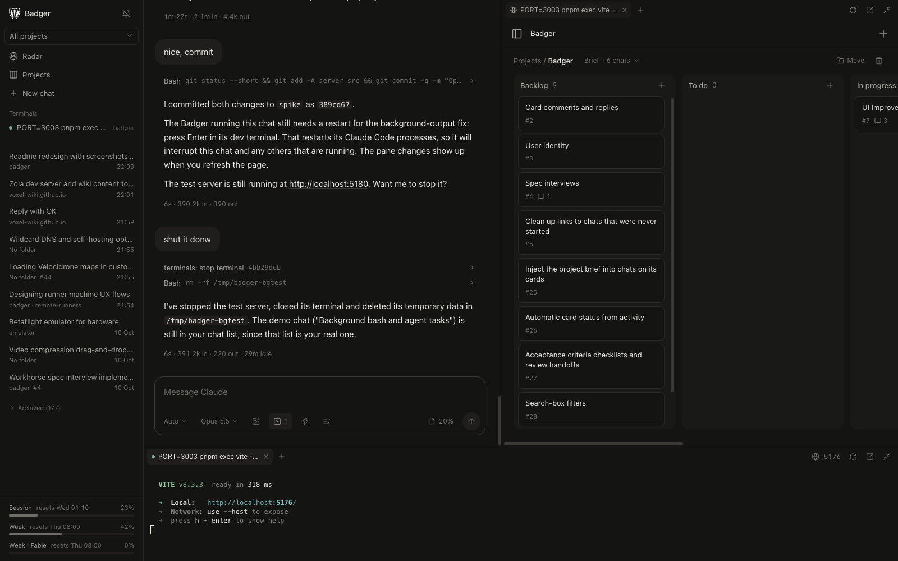
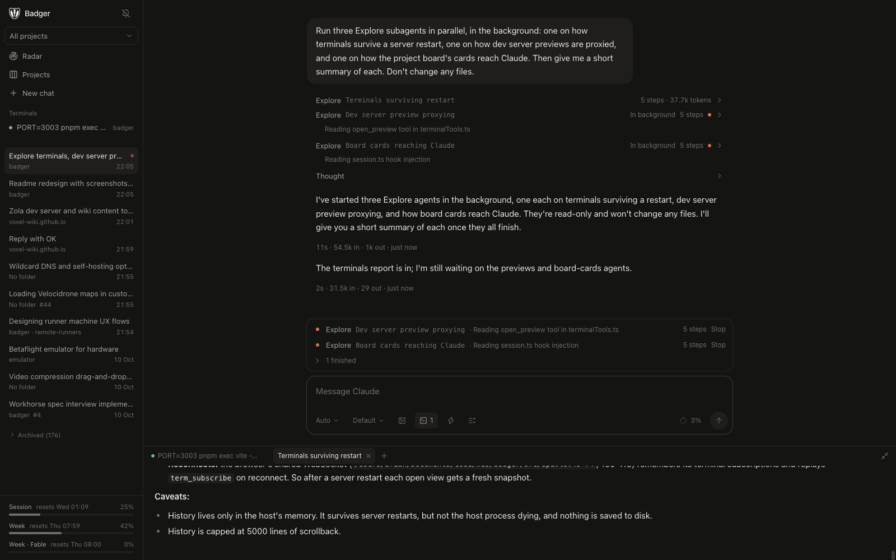
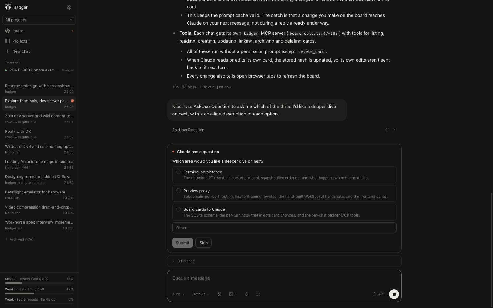
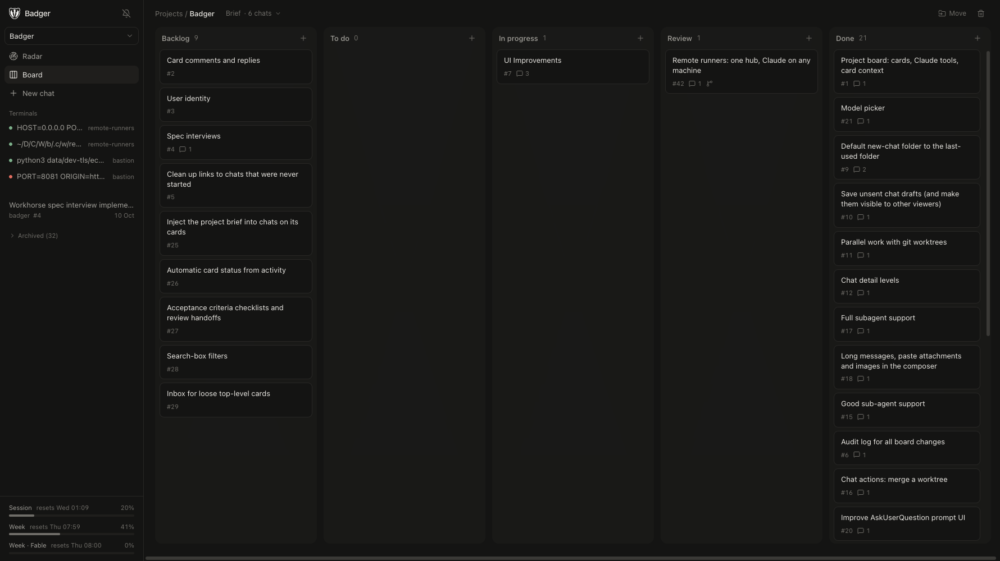

<h1 align="center">
  <br>
  Badger
</h1>

<p align="center">
  Claude Code in your browser, running on your own machine.<br>
  Chats, terminals, dev server previews and a project board in one tab.
</p>

<p align="center">
  
</p>

Badger is a web UI for [Claude Code](https://claude.com/claude-code) that runs on a server: your laptop, a NAS or a box in the cupboard. Start a chat from your phone, close the tab, and pick it up at your desk. Every chat is a real Claude Code session, so your `CLAUDE.md`, settings, hooks, skills and MCP servers all work, and chats you start in the terminal show up too.

## Features

- **The full Claude Code.** Driven through the [Agent SDK](https://www.npmjs.com/package/@anthropic-ai/claude-agent-sdk), not a reimplementation. Plan mode, auto mode, model picker, images, queued messages.
- **Terminals beside the chat.** Tiled around the conversation. Claude can start, read and restart them, and wait for a dev server to come up.
- **Previews.** Anything listening on a port opens in a panel at `<port>.your-host`, hot reload included. Claude can look into the page you have open, run code in it, read its console and screenshot it, so "this bit's broken" is enough to go on. It can also check pages itself in a headless Chromium (in the Docker image).
- **A project board.** Cards hold chats from any repo. Claude can read and update the board, and the radar shows what needs you across every project.
- **Tools and scripts.** Everything Claude can do in Badger is both a tool and a function it can script: `badger 'await badger.cards.list({ status: "review" })'`, so bulk changes are one loop instead of dozens of calls.
- **Worktrees.** Run several chats on one repo side by side, each in its own git worktree, and merge one back with a button.
- **Subagents and background tasks.** See what each agent is doing as it happens, and stop or background them.
- **Permissions in the browser.** Approve tool calls, answer Claude's questions and review plans from any tab or your phone, with notifications when something's waiting.

## Screenshots

| | |
|---|---|
|  |  |
| **Subagents**: watch them work, open one in a pane | **Questions and permissions**: answer from any tab |

<p align="center">
  <br>
  <b>Projects</b>: a board of cards, each holding its chats. Claude can read and update it too.
</p>

## Quick start

### Docker / Podman

```bash
mkdir badger && docker compose up -d   # on :3001
```

That pulls `ghcr.io/ria8651/badger` (amd64 and arm64). Open a terminal in Badger and log in once with `claude`, `gh auth login` and `git config --global …`. Everything persists in `./badger`: logins, transcripts, the database and your repos (in `~/code`).

### From source

```bash
cp .env.example .env   # set WORKSPACE_DIR
pnpm install
pnpm dev               # server on :3001, Vite on :5173
```

Production: `pnpm build && pnpm start`. Claude auth comes from `ANTHROPIC_API_KEY` if set, otherwise from the server user's `claude` login.

## Security

**Badger runs commands as its user and has no login of its own.** It binds to `127.0.0.1` by default. To reach it from elsewhere, put it behind a proxy that handles auth, such as [bastion](https://github.com/ria8651/bastion).

<details>
<summary>Self-hosting notes</summary>

- Proxies must pass WebSocket upgrades on `/ws` and keep the `Host` header.
- For previews, also send `*.<Badger's host>` to it (a wildcard DNS record, certificate and proxy route, behind the same auth), with WebSocket upgrades on any path. Previews only work when the browser reaches Badger by host name, not by IP address. Badger adds a small script to preview pages (served from `/__badger/`) so Claude can reach them; it loosens the page's Content-Security-Policy just enough for that.
- `latest` follows `spike`, and `v*` tags publish versions. `docker compose up -d --build` builds from your checkout instead, e.g. after adding tools to the `Dockerfile`.
- `BADGER_DIR` (default `./badger`) is mounted at `/badger` and used as the container's `HOME`. Any `user:` works as long as it can write the folder.
- Use git over HTTPS (`gh auth login` sets it up). `ssh` refuses to run as a uid with no passwd entry, which a custom `user:` is.
- The container user can't `apt-get`; install extra tools with `docker exec -u root badger apt-get install …`, or add them to the `Dockerfile`.
- Terminals don't outlive the container: restarting it restarts the server and the PTY host together.

</details>

## How it works

A Node server drives one Claude Code process per chat and streams it to any number of browser tabs over a WebSocket. Transcripts stay where Claude Code keeps them; Badger's own state (cards, attention, child chats) is a SQLite file.
